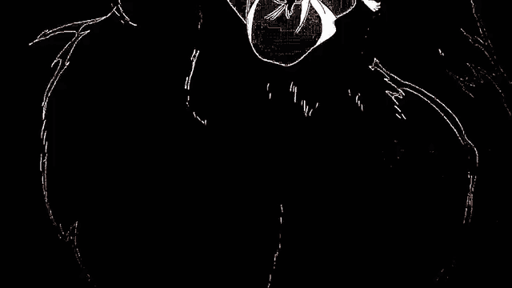
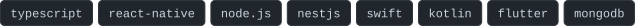
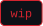

  

  <picture>
    <source media="(prefers-color-scheme: dark)" srcset="assets/header-dark.svg">
    <source media="(prefers-color-scheme: light)" srcset="assets/header-light.svg">
    
  </picture>

### — about

Software engineer in fitness-tech: backend, web and mobile in production.
On the side I build interesting apps, tools and projects. 

### — stack

### — selected work

<table>
  <tr>
    <td width="50%" valign="top">
      <a href="https://github.com/r415uk3/Tether"><b>Tether</b></a> 
      Native macOS app for Android file transfer over USB (MTP). No Electron. 
      <code>swift</code>
    </td>
    <td width="50%" valign="top">
      <a href="https://github.com/r415uk3/vivofpsunlocker"><b>vivofpsunlocker</b></a> 
      Unlock high refresh rate on Vivo devices. 
      <code>kotlin</code>
    </td>
  </tr>
  <tr>
    <td colspan="2">
      <b>sandyq</b>  — something new. coming soon.
    </td>
  </tr>
</table>

### — activity

<picture>
  <source media="(prefers-color-scheme: dark)" srcset="https://raw.githubusercontent.com/r415uk3/r415uk3/output/snake-dark.svg">
  <source media="(prefers-color-scheme: light)" srcset="https://raw.githubusercontent.com/r415uk3/r415uk3/output/snake.svg">
  
</picture>

 

<i>«I'm not the protagonist of a novel or anything...» — Kaneki Ken</i>

